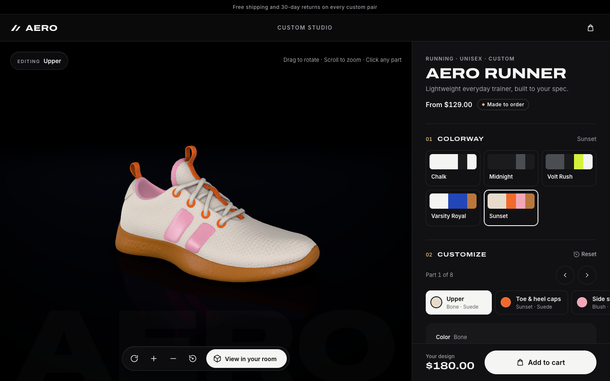
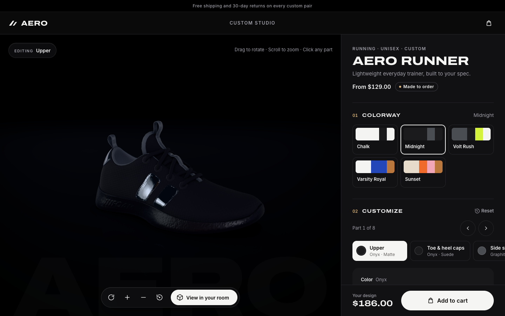
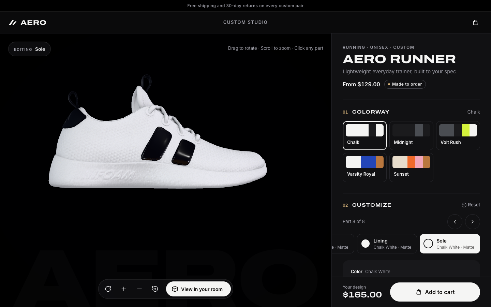
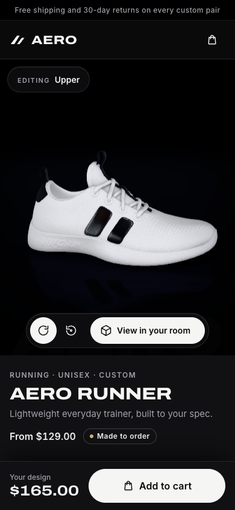

# Aero Runner · 3D Sneaker Configurator

An e-commerce product configurator built with **React Three Fiber**. Shoppers rotate and zoom a 3D sneaker, recolor each of its 8 parts, choose material finishes (matte, suede, leather, patent, metallic), see the price update with every upgrade, add the exact build to a cart, and place a true-to-size copy on their floor with **AR**.



| Midnight colorway | Sole close-up | Mobile |
| --- | --- | --- |
|  |  |  |

## Run it

```bash
npm install
npm run dev          # http://localhost:5173
npm test             # 55 unit + component tests (Vitest + Testing Library)
npm run build        # type-check + production bundle in dist/
```

Add `?perf` to the URL to show an FPS / draw-call meter.

## What's where

```
src/
  domain/         Pure TypeScript, no React or three.js — fully unit-tested
    catalog.ts        Parts, colors, finishes (with PBR values + price), colorways, sizes
    configurator.ts   Reducer: select part, set color/finish, apply colorway, size, reset
    surface.ts        Finish + color → one renderer-agnostic PBR spec
    pricing.ts        Base price + per-part finish upcharges, in integer cents
    cart.ts           Cart reducer + validated loading of the saved cart
  three/          The 3D scene
    SneakerStage.tsx  Canvas, camera, OrbitControls, contact shadow, toolbar
    StudioLighting.tsx Lightformer "photo studio" environment
    SneakerModel.tsx  Loads the Draco GLB, renders one PartMesh per part
    PartMesh.tsx      Physical material, damped color fade, hover/click picking
  ar/             "View in your room"
    ArDialog.tsx      Lazy-loads <model-viewer>, launches WebXR / Quick Look
    modelViewerAdapter.ts Applies the same PBR spec to model-viewer's materials
  ui/             Configurator panel, swatches, finishes, sizes, cart drawer
scripts/add-material-extensions.mjs   Prepares a GLB for clearcoat/sheen in AR
```

The key design choice: **`surfaceSpec()` is the single source of truth for how a part looks.** The R3F scene and the AR viewer both consume it, so the shoe you place in your room is the shoe you designed.

## What this project teaches

### Photographic rendering
- **A real photo studio for lighting**: Poly Haven's *Studio Small 08* HDRI (CC0) supplies the reflections, so the patent stripes show real softboxes. Two cool rim strips are layered into it to trace the silhouette on the black stage.
- **Dark luxury stage**: a blurred, depth-faded reflective floor (`MeshReflectorMaterial`) that fog dissolves into the backdrop, plus a soft key spotlight as the shadow caster.
- **Materials that know what they are made of**: each part has a substrate (`knit`, `synthetic`, `rubber`). "Matte" on the knit upper gets a fabric fuzz (sheen) and almost no mirror highlight, which is what stops it looking like plastic. On the sole it becomes satin rubber.
- **Lens behaviour**: high-threshold bloom so only real glints glow, a vignette, and a whisper of film grain.
- **Khronos PBR Neutral tone mapping**: the tone curve designed for e-commerce. It keeps a "Crimson" swatch looking like the real dye, where filmic curves shift hues. The AR preview uses the same curve.
- **N8AO ambient occlusion** (postprocessing): laces, eyelets and the collar sit *in* the shoe instead of floating on it.
- **Fabric detail**: the model's roughness texture is kept and normalised by its measured mean (0.70), so knit and grain vary across the surface while each finish keeps its designed overall sheen.
- **Hover outline** instead of a glow: a crisp edge around the part under the cursor.
- A gentle **vignette** turns a flat backdrop into a lit studio sweep.

### Lighting
- **Image-based lighting without an HDR file.** `StudioLighting` places emissive `Lightformer` cards (an overhead softbox, two rim strips and a warm fill) and renders them once into an environment map. Reflections on patent and metallic finishes come from these cards.
- A single directional **key light** gives shading direction; a low ambient fill lifts the shadows.
- **Two layered ContactShadows** instead of shadow maps: a wide, soft ambient shadow plus a tight, dark contact line where the sole meets the floor. Both are baked once (`frames={1}`) because the shoe never moves, only the camera.
- AccumulativeShadows was tried and rejected: it re-bakes on every render, and its plane read as a grey slab against the studio sweep.
- The loader is a DOM overlay driven by `useProgress`, not drei `<Html>` inside the canvas. As a Suspense fallback, `<Html>` unmounts its own React root mid-render, which React 19 rejects and which crashed the stage.
- **Physically based finishes:** each finish is a set of PBR numbers (`roughness`, `metalness`, `clearcoat`, `sheen`) on `MeshPhysicalMaterial`. Suede uses sheen, patent uses a glossy clearcoat, metallic uses metalness.

### Cameras
- 42° FOV, the product-shot range (wide-angle lenses distort the toe).
- **drei `CameraControls`** (camera-controls) instead of OrbitControls, for smooth, interruptible camera moves:
  - an **opening glide** from a wide shot into the hero three-quarter view;
  - **per-part close-ups**: picking "Laces" in the panel flies the camera above the laces. The views are plain data in `three/cameraViews.ts` (azimuth / polar / distance / target), with tested math.
- No panning, zoom limits and a polar-angle clamp, so the camera never goes under the floor but can still show the sole.
- Auto-rotate pauses while the shopper drags (resuming after 3.5 s) and stops when they inspect a part. With `prefers-reduced-motion` it is off by default, and all camera moves are instant.
- The zoom and reset buttons drive the controls from the DOM, so there are keyboard and accessibility alternatives to scroll and pinch.

### GLTF models
- The model is a **Draco-compressed GLB** (248 kB) with one material per shoe part. Material names are the configurable part ids, and a test checks that the catalog and the model agree.
- `collectParts()` reads geometry, normal maps and baked AO from the loaded glTF and renders **new** materials, instead of mutating the cached glTF materials.
- Clicking a part uses R3F raycasting (`onClick`, with a drag threshold so orbiting doesn't select).

### Performance basics
- **`frameloop="demand"`**: the GPU only renders when something changes (orbiting, a color fade, auto-rotate), so an idle tab costs almost nothing. Components call `invalidate()` when they need a frame.
- **Self-hosted variable fonts** (Archivo Expanded + Inter via Fontsource): no render-blocking third-party stylesheet.
- **Device pixel ratio clamped to 2**, which saves a lot of fill rate on 3× phones.
- **Self-hosted Draco decoder** in `public/draco/` (no CDN at runtime). The GLB is `<link rel="preload">`-ed and `useGLTF.preload`-ed.
- **Resilience:** error boundaries keep the configurator and cart working if WebGL or the model fails, and auto-rotate pauses while a dialog covers the stage.
- **Code splitting:** three.js gets its own long-cached chunk, and model-viewer (~70 kB gzipped) loads only when someone taps "View in your room".
- Changing a finish toggles clearcoat/sheen, which recompiles that material's shader once. Color changes never recompile.

## AR: how "View in your room" works

`<model-viewer>` loads the same GLB, `applyDesignToModelViewer()` paints the customer's design onto it, and `scale` is set so the shoe is exactly **0.29 m** long. With `ar-scale="fixed"` it appears at real size on the floor.

| Device | Mode | Notes |
| --- | --- | --- |
| Android + Chrome (ARCore) | WebXR | Uses the live, customized scene |
| iPhone / iPad Safari | Quick Look | model-viewer generates a USDZ from the customized scene |
| Desktop | — | Shows a 3D preview and explains how to open AR on a phone |

**Scene Viewer is deliberately left out.** It re-downloads the original GLB from its URL, so the customer's colors would be lost. Showing the wrong colorway in AR is exactly the kind of thing that causes returns.

**Testing AR on a phone:** WebXR and Quick Look need **HTTPS**, so a LAN address like `http://192.168…` won't work. Deploy `dist/` to any static host (Netlify, Vercel, Cloudflare Pages) and open it on the phone.

`scripts/add-material-extensions.mjs` (already applied to the bundled model, `npm run model:extensions`) declares `KHR_materials_clearcoat` and `KHR_materials_sheen` on every material. Without them, model-viewer can't show gloss or suede sheen in AR. Run it on any replacement model.

## Swapping in another product

1. Export a GLB whose **material names** are your part ids (Draco-compress it with `gltf-transform` or Blender).
2. Run `node scripts/add-material-extensions.mjs path/to/model.glb`.
3. Update `PARTS`, `COLORWAYS` and the `GLB_MATERIAL_NAMES` list in `catalog.test.ts`, then set `SHOE_LENGTH_METERS` (in `ar/modelViewerAdapter.ts`) to the real product size.

## Ideas for next steps

- Shareable designs: encode the design in the URL, and add a QR code on desktop that opens AR on the phone.
- Connect the cart to a real checkout (Shopify Storefront API or Stripe Checkout).
- **The biggest remaining realism lever is the asset.** This free model is clean but simple, so commission or buy a scanned, multi-part sneaker (one material per part, 2K textures) and drop it in (see "Swapping in another product").
- KTX2 / Basis texture compression for larger models.
- Pre-compile the clearcoat/sheen shader variants (`gl.compileAsync`) to remove the one-time hitch on the first finish change.

## Credits

Studio lighting: [Studio Small 08](https://polyhaven.com/a/studio_small_08) by Sergej Majboroda, Poly Haven (CC0).
Shoe model from [pmndrs/examples](https://github.com/pmndrs/examples/tree/main/examples/shoe-configurator) (MIT License). "Aero Runner" and "Aero Studio" are fictional names for this demo.
